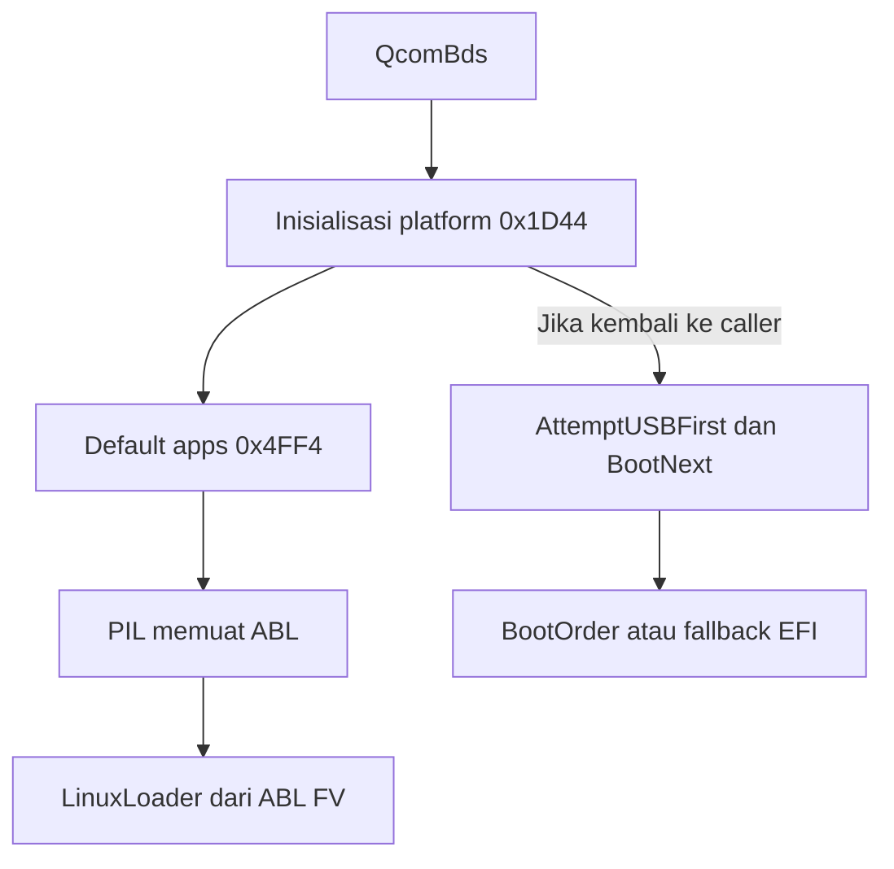

# Hasil penelusuran jalur SuperFastboot pada firmware SM8750

**Kesimpulan:** ditemukan titik-titik pemanggilan boot yang konkret, tetapi
belum ditemukan jalur yang terbukti menjalankan BDS kustom pada perangkat ini.
Port tanpa partisi `efisp` membutuhkan cara masuk sebelum LinuxLoader asli
mengambil alih. Menambah folder atau mengganti nama partisi saja tidak cukup.

## Ruang lingkup dan kekuatan bukti

Masukan adalah `gpt.zip` yang diberikan pengguna. Pemeriksaan dilakukan
offline: ekstraksi, pembacaan struktur, perbandingan byte, disassembly ARM64,
dan pencocokan source acuan. Tidak dilakukan flashing, pengubahan GPT,
pengubahan status lock, atau pengujian pada perangkat fisik.

| Label | Metadata dari berkas |
|---|---|
| ROM CN | `device=annibale`, `OS3.0.307.0.WPKCNXM` |
| Engineering ROM | `device=annibale`, `260223.1.WPKCNXM.FACTORY` |
| Hasil sebelumnya | `result/boot.efi`, 1.183.744 byte |
| Modul pembanding | `magisk_module.zip`, versi 6.1 / versionCode 13 |

Metadata engineering ROM tidak menyatakan Android 15 atau OS2/OS3 secara
langsung. Label folder bukan bukti versi Android. File pengujian hanya
melaporkan gejala brick dan logo; tidak memuat log eksekusi bootloader.

## 1. Rekonstruksi patch lama berhasil

PE hasil ekstraksi ABL engineering berukuran sama dengan `result/boot.efi`.
Seluruh perbedaannya berjumlah 9 byte pada empat rentang berikut.
Offset adalah **offset file PE yang telah diekstrak**, bukan offset `abl.elf`.

| Offset PE | Sebelum | Sesudah | Perubahan yang terlihat |
|---|---|---|---|
| `0x3A72C` | `62 a7 ff 97` | `20 00 80 52` | `BL 0x244B4` menjadi `MOV W0,#1` |
| `0x3BAAC` | `28 00 80 52` | `08 00 80 52` | `MOV W8,#1` menjadi `MOV W8,#0` |
| `0x3BAEC` | `ea 03 01 39` | `ff 03 01 39` | `STRB W10,[SP,#0x40]` menjadi `STRB WZR,[SP,#0x40]` |
| `0x46BE8` | `e9 02 00 b0 29 8d 2a 91` | `69 02 00 b0 29 19 0e 91` | Pasangan ADRP/ADD mengarah dari string `unlocked` ke `locked` |

Hash PE engineering asli:

`6270557b012660bd4d876a68368321d17a08efdb2e5a7d931a9f99346da736c7`

Hash hasil patch/reproduksi:

`d7456c0e5d6d102cad963ea9c27f4b5fc3c999d6ebce5ade058efd52c352ef83`

Ini memulihkan **resep patch biner yang dapat direproduksi**. Source C asli
OEM maupun project AI sebelumnya tidak dapat dipulihkan persis dari hasil
biner saja. Keberhasilan rekonstruksi tidak membuktikan keberhasilan boot
atau fake lock pada perangkat fisik.

ABL CN berbeda dari basis engineering, termasuk ukuran PE: 1.179.648 byte
dibanding 1.183.744 byte. Offset engineering tidak berlaku otomatis untuk CN.

## 2. Ketidakcocokan format merupakan kandidat utama penyebab brick

| Berkas | Struktur yang ditemukan |
|---|---|
| `cn/abl.elf` dan `eng rom/abl.elf` | ELF32 ARM, 335.672 byte, entry `0x9FA00000` |
| Segmen payload ABL | Offset ELF `0x1000`, ukuran `0x50000`, berisi firmware volume |
| LinuxLoader | PE ARM64 di dalam firmware volume yang dikompresi LZMA |
| `result/boot.efi` | PE ARM64 langsung, dimulai dengan `MZ`, 1.183.744 byte |

PILDxe SM8750 berisi validasi ELF dan diagnostik `Not an elf header`,
`Not 32bit ELF`, serta kegagalan autentikasi PIL. QcomBds memuat ABL lewat
jalur PIL sebelum meluncurkan aplikasi bernama `LinuxLoader` dari ABL FV.

Pada PILDxe yang diberikan, fungsi validasi mulai di RVA `0x2364`. Di
`0x2398–0x23AC`, input dibandingkan dengan signature ELF empat byte pada data
`0x13693`; bila tidak cocok, jalur error merujuk `Not an elf header`.
Pemanggilan validasi dan penanganan gagal terlihat di `0x2898–0x28BC`.

**Inferensi kuat, belum dikonfirmasi oleh log:** jika byte `boot.efi` memang
ditulis langsung menjadi isi ABL, jalur pemuatan ABL normal akan menerima
format yang berbeda dari ELF/FV yang diharapkan. Ini sudah dapat menjelaskan
kegagalan boot sebelum membahas keberadaan SuperFastboot.

Logo POCO tanpa padlock belum membuktikan LinuxLoader hasil patch dieksekusi.
Firmware `uefi.elf` sendiri memuat DisplayDxe dan gambar `logo1.bmp`.
Diagnosis final tetap memerlukan isi partisi setelah flashing dan log tahap
PIL/ABL, karena keduanya tidak ada dalam ZIP.

Membungkus PE kembali menjadi ELF/FV juga belum menjamin dapat dijalankan:
metadata, hash segmen, signature, kebijakan autentikasi dan rollback perlu
sesuai. Status bootloader Android terbuka tidak membuktikan seluruh tahap
secure boot menerima image boot firmware yang diubah.

## 3. Jalur pada proyek acuan

README upstream dan skrip modul menunjukkan urutan:

1. ABL bawaan yang mempunyai jalur GBL membaca BDS dari partisi raw `efisp`.
2. BDS menjalankan filesystem stack, lalu mencari boot entries.
3. Berkas `BOOTENTRIES` dan LinuxLoader hasil patch berada di folder
   `efisp` pada filesystem `persist`.
4. BDS memilih dan menjalankan aplikasi EFI berikutnya.

Jadi **partisi raw `efisp`** adalah lokasi BDS tahap awal, sedangkan
**folder `persist/efisp`** adalah lokasi berkas yang dibaca setelah BDS hidup.

Pada ABL `myron`, `myron_global`, dan `nezha_global` dalam modul referensi
ditemukan string UTF-16 `efisp` serta diagnostik pemuatan/starting GBL.
Pada PE ABL CN dan engineering SM8750 yang diberikan, penanda itu tidak
ditemukan. Ini adalah hasil pemeriksaan atas dua build tersebut, bukan bukti
bahwa semua SM8750 atau semua versi firmware tidak mungkin memiliki jalur lain.

Source patcher upstream `submodules/patcher/src/patchs/core.c` mengganti string
`efisp` menjadi `nulls` pada ABL turunan. Perubahan itu menonaktifkan pencarian
GBL ulang oleh aplikasi yang dijalankan setelah BDS; bukan menambahkan loader
baru ke ABL yang sejak awal tidak mempunyainya.

Source BDS `SuperFbFat.c` memuat driver FAT dan ext4 sendiri, sehingga akses
ke `persist/efisp` merupakan kemampuan **BDS yang sudah berjalan**. Ini belum
menyelesaikan cara firmware SM8750 pertama kali masuk ke BDS tersebut.

## 4. Jalur konkret yang ditemukan pada SM8750

Kedua ROM memuat QcomBds dengan isi PE identik:

- FFS GUID: `5a50aa81-c3ae-4608-a0e3-41a2e69baf94`.
- SHA-256: `c15c9077837d13420a860a20a6480d9dd8ae76f31828890a598f38be47d2bd78`.
- FV awal `uefi.elf` berada di offset `0x1000`.
- QcomBds muncul dalam keluaran LZMA pada offset file `0x4E268`.

Semua alamat berikut adalah **RVA dalam PE QcomBds**. Pada modul ini image
base adalah nol dan offset raw section sama dengan RVA yang dibahas.
Nama fungsi hasil inferensi ditandai dengan `~` karena simbol lengkap tidak
tersedia.

| Titik | Bukti pemanggilan |
|---|---|
| `0x1FA8` | Memanggil `0x1D44`, inisialisasi BDS/platform |
| `0x1DEC` | Dalam inisialisasi itu, memanggil `0x4FF4` (~launch default apps) |
| `0x50E0` | Membaca konfigurasi string `DefaultBDSBootApp` lewat helper `0x8690` |
| `0x510C` | Memanggil `0x4E90`, mempersiapkan/memuat ABL melalui PIL |
| `0x5254` | Memanggil helper `0x7D2C` (~LaunchAppFromGuidedFv) |
| Data `0x1D0E8` | GUID ABL FV `046fae99-cf2e-49ed-a6a8-a1488b7e80d3`, argumen ke helper |
| `0x5258` | Masuk helper penanganan kegagalan jika aplikasi kembali |
| `0x2000–0x209C` | Jalur variabel `AttemptUSBFirst`, sesudah panggilan init |
| `0x20A0–0x20BC` | Membaca variabel UEFI `BootNext`, juga sesudah init |
| `0x2628–0x2630` | Referensi string UEFI `BootOrder` |
| `0xF00C–0xF03C` | Membentuk path fallback `\EFI\BOOT\BOOTAA64.EFI` dan memanggil `LoadImage` |

Urutan cabang yang relevan:

**Implikasi:** menemukan string `BOOTAA64.EFI` saja tidak cukup. Pemanggilan
LinuxLoader terjadi di jalur inisialisasi sebelum pembacaan BootNext. Pada
boot normal, LinuxLoader mengambil alih menuju Android/fastboot OEM dan tidak
kembali. Kandidat jalur alternatif perlu diuji keterjangkauannya dahulu.

## 5. Konfigurasi sebenarnya berada di xbl_config.elf

FFS `uefiplat.cfg` yang ditemukan di UEFI berisi pemberitahuan bahwa pengaturan
dipindahkan ke device tree. Nilai yang relevan dapat dibaca dari FDT dalam
`xbl_config.elf`.

| Path/property | Nilai | Offset nilai CN | Offset nilai engineering |
|---|---|---|---|
| `/sw/uefi/str_param/DefaultBDSBootApp` | `LinuxLoader` | `0x242D8` | `0x23F68` |
| `/sw/uefi/str_param/DefaultChargerApp` | `QcomChargerApp` | `0x242BC` | `0x23F4C` |
| `/sw/uefi/int_param/EnableShell` | `0x0000000000000001` | `0x23F48` | `0x23BD8` |
| `/sw/uefi/int_param/DetectRetailUserAttentionHotkey` | `0x0000000000000000` | `0x24128` | `0x23DB8` |
| `/sw/uefi/int_param/DetectRetailUserAttentionHotkeyCode` | `0x0000000000000017` | `0x2413C` | `0x23DCC` |
| `/sw/uefi/int_param/SecurityFlag` | `0x00000000000000C4` | `0x24100` | `0x23D90` |
| `/sw/uefi/int_param/AllowNonPersistentVarsInRetail` | `0x0000000000000001` | `0x241C8` | `0x23E58` |

Angka di atas mempertahankan pasangan cell big-endian 32-bit dari DT sebagai
nilai 64-bit. `EnableShell=1` tidak membuktikan aplikasi shell tersedia atau
bisa dijangkau oleh pengguna. Modul Ebl ditemukan; jalur hotkey retail pada
konfigurasi ini bernilai nol. BDS menu config juga menyebut beberapa aplikasi,
tetapi nama dalam menu tidak otomatis membuktikan aplikasinya disertakan.

FDT juga memuat `/soc/pil/pil_images/ABL_CFG` dengan `FwName=ABL` dan konfigurasi
partisi untuk jalur PIL. Properti `Unlock` di node ini **tidak diartikan sebagai
status bootloader Android**: pada PIL istilah itu dapat merujuk operasi subsistem.

## 6. Kandidat arsitektur port dan hal yang belum selesai

| Kandidat | Yang sudah diketahui | Penghalang yang masih harus dibuktikan |
|---|---|---|
| GBL raw `efisp` seperti acuan | Ada pada ABL pembanding | Loader yang sama belum ditemukan pada dua ABL SM8750 ini |
| QcomBds sebelum LinuxLoader | Titik dispatch `0x5254` dan ABL FV GUID terpetakan | Cara memasukkan perubahan yang diterima autentikasi firmware |
| UEFI BootNext / FAT fallback | Implementasi dan path standar ada | Keterjangkauan sebelum default app, persistensi variabel, dan kebijakan image |
| ABL ELF/FV yang mengemas chainloader | Format dasar dapat diekstrak | Pengemasan ulang, signature/hash, pemanggilan BDS dan kompatibilitas platform |

Prioritas penelitian berikutnya:

1. Verifikasi kondisi pemuatan image pada perangkat dalam status bootloader
   yang digunakan, memakai log PIL/UEFI dan image ABL asli yang cocok.
2. Tetapkan jalur masuk yang dapat dijalankan sebelum LinuxLoader. Sasaran
   teknis yang sudah terukur adalah dispatch ABL FV di QcomBds atau entry
   LinuxLoader dalam container ABL yang valid.
3. Baru pilih media penyimpanan payload setelah entry terbukti. Pada jalur
   filesystem, FAT dapat dipertimbangkan; akses ext4 `persist` memerlukan
   driver yang sesuai. Jangan menganggap semua partisi bebas dipakai.
4. Uji enumerasi UFS/partisi, tombol, display dan USB gadget pada BDS. Arsitektur
   ARM64 sama tidak menjamin protokol firmware SM8850 dan SM8750 sama.
5. Pertahankan bootloader OEM dan jalur pemulihan selama pengembangan; setiap
   build eksperimental perlu log dan identitas firmware yang tepat.

ZIP masukan tidak memuat GPT lengkap, isi partisi sesudah gagal flash,
variabel UEFI runtime, atau log kegagalan boot. Jadi klaim bahwa jalur ini sudah
berfungsi untuk semua perangkat SM8750 belum dapat dibuat.

Perintah temp-boot EFI dalam README upstream berlaku ketika **SuperFastboot
sudah hidup**. Itu tidak membuktikan fastboot OEM pada perangkat ini menerima
aplikasi EFI mentah sebagai image boot.

## 7. Sumber yang diperiksa

- [Repo utama gbl_root_canoe](https://github.com/SuperTurtleDev/gbl_root_canoe),
  commit `4ef438cfde42943694fde5753bbf5d8c0b4ec02e`.
- [README pada commit acuan](https://github.com/SuperTurtleDev/gbl_root_canoe/blob/4ef438cfde42943694fde5753bbf5d8c0b4ec02e/README.md).
- [Core patcher](https://github.com/SuperTurtleDev/gbl_root_canoe/blob/4ef438cfde42943694fde5753bbf5d8c0b4ec02e/submodules/patcher/src/patchs/core.c).
- [Filesystem BDS](https://github.com/SuperTurtleDev/gbl_root_canoe/blob/4ef438cfde42943694fde5753bbf5d8c0b4ec02e/submodules/uefi/edk2/QcomModulePkg/Application/LinuxLoader/SuperFbFat.c).
- [Entry BDS](https://github.com/SuperTurtleDev/gbl_root_canoe/blob/4ef438cfde42943694fde5753bbf5d8c0b4ec02e/submodules/uefi/edk2/QcomModulePkg/Application/LinuxLoader/LinuxLoader.c).
- Berkas `prompt.txt`, `test.txt`, firmware dan skrip pembanding dalam ZIP
  pengguna; hash dan bukti struktur ada di folder `evidence/`.

Thread XDA yang disebut di prompt tidak berhasil dibaca: akses web gagal dan
permintaan HTTP langsung mendapat 403. Tidak ada klaim di laporan ini yang
dianggap telah dikonfirmasi dari thread tersebut.
