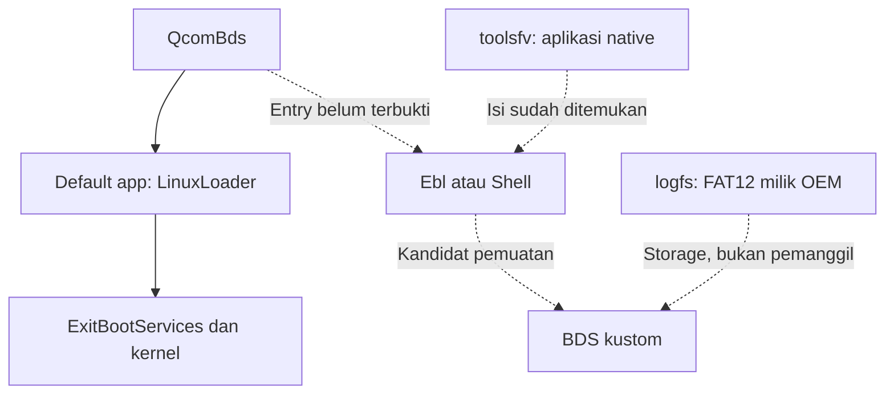

# Log perangkat dan kandidat entry dari Tools FV

Tanggal pengambilan: **7 November 2026, Asia/Jakarta**. Pengambilan dilakukan
pada Android yang sedang berjalan dengan uid=0 melalui Desktop Commander.
Partisi dibuka hanya untuk membaca. Tidak ada mount, flash, reboot, pemanggilan
command OEM, atau perubahan variabel/konfigurasi boot pada tahap ini.

**Hasil utama:** log UEFI asli tersedia dan Tools FV berisi aplikasi Shell.
Belum ada bukti bahwa Shell/BDS kustom bisa dipanggil sebelum LinuxLoader.

## 1. Apa yang diambil

| Masukan privat | Rentang yang dibaca | SHA-256 |
|---|---|---|
| `toolsfv` | 1.048.576 byte dari awal partisi | `89c78f7adf193dbecdde5835fafddf8a1f7ded7c1af73136439359ec90d56a88` |
| `logfs` | Volume FAT sepanjang 5.242.880 byte menurut BPB | `1e20c12c68dc23708a28dcb9ff75eb2a083565ef2e92785d299c3bd28e9f5221` |
| `xbl_sc_logs` | 131.072 byte dari awal partisi | `bbbd4032e6f34db8e5b9ddf96ee59da2c90700e4b18da508972ec4f0cd3e8338` |

Probe tambahan membaca header 4 KiB pada partisi terpilih dan memeriksa
visibilitas log/kernel bootconfig. Batas partisi berasal dari diagnostik GPT
sebelumnya. Collector yang disimpan dalam repo kemudian diuji pada perangkat;
ketiga hash hasil baca ulang sama dengan snapshot awal.

Masukan asli berisi firmware dan identifier dalam log. Byte tersebut disimpan
privat, **tidak dimasukkan ke GitHub**. Manifest publik ada di LIVE_INPUTS.json.
Analyzer hanya mengeluarkan metadata dan baris log yang cocok dengan daftar
pola lengkap; baris identifier dan bootargs tidak diekspor.

## 2. `logfs` ternyata volume FAT12 yang berfungsi

Parser memeriksa BPB, batas data, dua salinan FAT, rantai cluster, dan panjang
file. Ia tidak memasang filesystem Android. Hasil:

| Field | Nilai |
|---|---|
| Ukuran sektor BPB | 4.096 byte |
| Sektor per cluster | 1 |
| Jumlah sektor volume | 1.280 |
| Ukuran volume FAT | 5 MiB |
| Ukuran partisi dari GPT sebelumnya | 8 MiB |
| Jumlah data cluster | 1.273, konsisten dengan FAT12 |
| Salinan FAT | 2, seluruh byte sama |
| Root directory | Offset volume `0x3000` |
| Data cluster pertama | Offset volume `0x7000` |

Ada lima file: `UEFILOG0.TXT` sampai `UEFILOG4.TXT`, masing-masing 65.536 byte.
Masing-masing memuat 629 baris sebelum padding nol. Hash setiap file dan
cuplikan terpilih ada di [logfs.json](evidence/live_2026_11_07/logfs.json).
Timestamp header berasal dari pencatat firmware; zona waktu dan kecocokannya
dengan jam Android tidak diasumsikan.

FAT bukan otomatis ESP. Metadata GPT yang sudah dibaca tidak mempunyai type
GUID ESP pada enam LUN. Spesifikasi UEFI juga membedakan format filesystem
FAT dari identitas system partition; lihat [UEFI 2.10, 13.3](https://uefi.org/specs/UEFI/2.10/13_Protocols_Media_Access.html).
Adanya FAT12 OEM ini tidak membuktikan fallback `BOOTAA64.EFI` dijalankan.

Selisih 3 MiB terhadap ukuran partisi belum dinilai sebagai ruang bebas untuk
payload. Logfs adalah penyimpanan OEM dengan rotasi log; jangan menganggap
tail atau file yang ditambahkan akan dipertahankan oleh semua firmware.

## 3. Bukti runtime yang sekarang tersedia

Berikut baris dari `UEFILOG0.TXT`; nomor mengacu pada file asli, bukan logcat.

| Baris | Isi yang relevan |
|---|---|
| 7 | `S - Secure Boot: On` |
| 295–296 | `PROD Mode : TRUE`, `Retail : TRUE` |
| 394 | `INFO: UEFI NV tables are enabled as VOLATILE!` |
| 432 | `POST Time [ 4093] OS Loader` |
| 439 | Loader build `Jul 22 2026 23:10:59` |
| 485–486 | Slot `_a`, lalu Mission Mode |
| 512–514 | Set RoT/Boot State success, lalu autentikasi VB2 berakhir `orange` |
| 523 | `VB2: boot state: orange(1)` |
| 628–629 | Penghentian UEFI Boot Services pada 5.196 ms dan `Start EBS` |

Kelima log mempunyai state `orange` serta pesan NV volatile. `/proc/bootconfig`
pada pengambilan juga melaporkan `secureboot=1`, `verifiedbootstate=orange`,
dan `vbmeta.device_state=unlocked`. Ini memberi sumber tambahan di luar
`getprop` yang di-spoof. Bootconfig tetap merupakan permukaan yang dibaca dari
kernel, bukan attestasi perangkat keras yang independen dari semua modifikasi.

**Implikasi:** unlock Android dan status secure boot firmware merupakan
lapisan berbeda. Log ini tidak membuktikan image ABL/UEFI yang diubah akan
diterima. Pesan NV volatile juga melemahkan asumsi bahwa variabel boot yang
ditulis akan bertahan lintas reboot dalam konfigurasi ini. Pesan tersebut
bukan bukti bahwa seluruh penyimpanan UEFI/TEE atau RPMB bersifat volatile.

Ini snapshot log tersimpan, bukan hasil boot image eksperimen baru. Tidak ada
log yang membuktikan BDS kustom berjalan. Error SPSS/SMC yang muncul di bagian
lain log tidak boleh langsung dijadikan penyebab brick: rekaman ini juga
melanjutkan boot sampai ExitBootServices.

## 4. Tools FV memuat Shell, Ebl dan Menu

Awal `toolsfv` adalah FV berformat FFS2, bukan ELF ABL. Header FV valid dengan
panjang `0x60000`; sisa pembacaan 1 MiB bernilai nol. Stream LZMA pada offset
partisi `0x78` membuka FV dalam buffer dekompresi di `0x8`. Namespace FV bagian
dalam adalah:

`c4be3b58-1c19-4881-b101-8d02fce6708b`

Ditemukan **19 aplikasi PE** dan 12 file konfigurasi bernama. Aplikasi pilihan:

| Aplikasi | FFS GUID | Ukuran PE |
|---|---|---|
| Shell | `7c04a583-9e3e-4f1c-ad65-e05268d0b4d1` | 1.015.808 byte |
| Ebl | `3cef354a-3b7a-4519-ad70-72a134698311` | 118.784 byte |
| Menu | `a9f91c13-4df7-3952-6811-f6b4479b3c0c` | 57.344 byte |
| Cmd | `484523a5-6a18-463f-ea1d-de3d740abad5` | 110.592 byte |

Manifest PE/FFS, hash, asal dekompresi dan FV ada di
[toolsfv.json](evidence/live_2026_11_07/toolsfv.json). Pemindaian juga melihat
header FV pada payload embedded lain; itu tidak dianggap sebagai volume yang
telah dipasang atau aplikasi yang telah dieksekusi.

Ebl dalam main UEFI merujuk GUID Tools FV di offset PE `0x190B8` dan memiliki
teks bantuan `MountFv toolsfv`. Ebl di main UEFI dan Ebl di Tools FV merupakan
dua PE berbeda; nama UI/FFS yang sama tidak berarti byte atau perilakunya sama.
Hubungan tersebut diperiksa lagi terhadap `gpt.zip` asli pada
[entry_relationships.json](evidence/live_2026_11_07/entry_relationships.json).

Header FV dan keberadaan aplikasi hanya membuktikan isi media. Belum dibuktikan
kapan Tools FV dipasang, siapa yang memanggil Shell, atau kebijakan autentikasi
untuk aplikasi kustom dari volume lain.

## 5. Ide jalur yang layak diteruskan

**Kandidat paling konkret adalah entry ke Ebl/Shell bawaan saat Boot Services
masih aktif, lalu pemuatan aplikasi dari FV/filesystem.** Perangkat sudah
memiliki bahan untuk jalur itu, sehingga penelitian bisa berfokus pada caller
dan syarat entry, bukan menganggap perlu membuat ESP terlebih dahulu.



Penghalang yang sudah terukur:

- Dispatch default QcomBds tetap memakai GUID ABL FV
  `046fae99-cf2e-49ed-a6a8-a1488b7e80d3`, berbeda dari Tools FV. Mengganti nama
  `DefaultBDSBootApp` menjadi `Shell` saja tidak menyediakan namespace yang benar.
- Callsite default apps di RVA `0x1DEC` mendahului pemanggilan handler setup
  di RVA `0x1E70`. Urutan itu tidak memberi jalur preemption baru pada boot
  normal. Kedua instruksi dan handler disimpan di bukti hubungan entry.
- Menu OEM yang dianalisis sebelumnya memberikan argumen
  `-nomap -nostartup` pada Shell. Menaruh `startup.nsh` tidak otomatis berarti
  skrip akan dijalankan oleh entry menu tersebut.
- Kernel Android pada log di atas dimulai setelah Boot Services dihentikan.
  Menjalankan file EFI dari userspace/kernel sesudah fase itu tidak dengan
  sendirinya memulihkan lingkungan Boot Services/protokol platform yang diperlukan.

Jadi logfs dapat ditelusuri sebagai media FAT yang sudah dikenali firmware,
tetapi belum menjadi pengganti siap pakai bagi raw `efisp` proyek acuan. Tetap
perlu membuktikan pemanggil sebelum LinuxLoader dan kebijakan LoadImage.

Prioritas berikut: caller Ebl dan mekanisme mount Tools FV, syarat retail/menu,
serta autentikasi aplikasi pada jalur yang benar-benar terjangkau. Belum ada
perintah flashing atau pengubahan variabel yang disarankan dari snapshot ini.

## 6. XBL dan batas diagnosis kegagalan lama

`xbl_sc_logs` diawali magic `IMTL`. Ditemukan tujuh kelompok log dengan marker
463 sampai 469 yang berjarak `0x4000`; marker juga muncul kembali dalam isi
masing-masing log. Pencarian terbatas untuk kegagalan autentikasi, invalid ELF,
dan PIL/ABL gagal tidak menghasilkan match pada snapshot ini.

Itu bukan bukti bahwa percobaan brick terdahulu tidak pernah gagal pada PIL.
Rentang rekaman dapat sudah berotasi atau gagal sebelum pesannya tersimpan.
Pola pencarian, offset marker dan hash dicatat di
[xbl.json](evidence/live_2026_11_07/xbl.json).

## 7. Reproduksi dan pemulihan

Gunakan ZIP live input privat beserta `gpt.zip` asli untuk cross-check firmware:

```bash
.venv/bin/python src/analyze_live_boot.py /path/to/SM8750-live-boot-inputs-2026-11-07.zip --firmware /path/to/gpt.zip --out generated/live
.venv/bin/python -m unittest discover -s tests -v
.venv/bin/python src/verify_research.py /path/to/gpt.zip --upstream ../gbl_root_canoe --live-archive /path/to/SM8750-live-boot-inputs-2026-11-07.zip --log generated/full-validation.txt
```

Collector Node untuk pengambilan ulang ada di `tools/collect_live_boot.js`.
Ia membutuhkan akses baca root dan Node yang tersedia pada lingkungan pengguna;
bukan perintah bawaan Android. Mode `capture` hanya menerima tiga nama partisi
di atas dan mengeluarkan gzip/base64 ke stdout. Semua open block device memakai
mode `r`; data tidak ditulis kembali ke partisi. Batas pembacaan khusus snapshot
ini harus diperiksa ulang sebelum dipakai pada perangkat lain.

Input mentah tetap privat. Cukup source dan hasil analisis yang sudah dibatasi
untuk disinkronkan ke repo publik. Ketika workspace hilang, clone repo menurut
RECOVERY.md dan sediakan kembali dua ZIP masukan dengan hash yang cocok.
